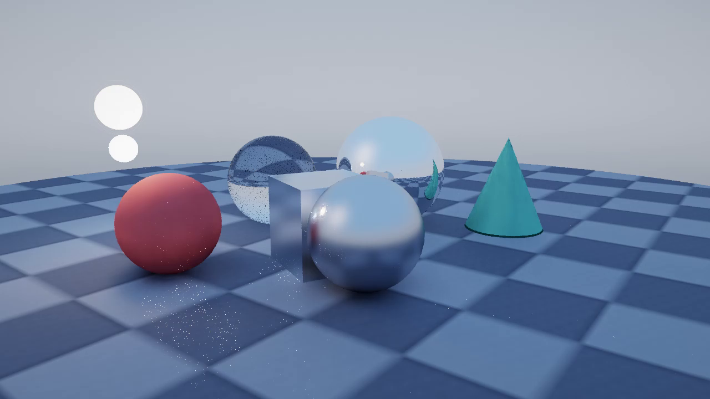

# Vulkan Ray Tracer

A real-time path tracer that runs from a single 800 KB executable. Vulkan ray tracing, no
installer, no runtime dependencies beyond a Vulkan driver, and nothing to install — the
assets ship in one `.pak` beside the binary. There are two ways to run it: download the
Windows executable, or open the live web build at
[duffyjp.github.io/strata_raytracer](https://duffyjp.github.io/strata_raytracer/) — the same
scene and renderer rewritten for WebGPU.

[](docs/output_example.mp4)

## What it is

An iterative path tracer: one to a dozen samples per pixel per frame, accumulated over
frames, filtered, targeting 60 fps. The scene is a cube, a cone, and three spheres
— one of them a mirror ball — lit by emissive spheres that orbit on their own, over a
checkerboard floor.

It renders through the Vulkan ray-tracing pipeline (`VK_KHR_acceleration_structure` plus
`VK_KHR_ray_tracing_pipeline`), with a compute path using ray queries for drivers that have
one and not the other. Shading is Lambertian diffuse and GGX specular with half-vector
importance sampling, direct light is estimated with next-event estimation towards the
emissive area lights, and the image is tone mapped with ACES.

Two pieces do the work beyond tracing itself.

**An adaptive quality controller.** Two timestamp queries bracket each command buffer, so
the GPU reports how long a frame really took without stalling the pipeline. The controller
spends the frame budget on image quality — samples first, then supersampling above the
window's own resolution — and acts on streaks of readings rather than on one slow frame.
Cost is modelled as two terms: tracing, which scales with sample count, and the denoiser,
which charges per traced pixel regardless of samples. The denoiser's price is measured on
the hardware it runs on by timing an actual switch of it, because that cost varies by
roughly forty times between GPUs and resolutions and no fixed constant describes it.

**A denoiser written in plain GLSL compute.** SVGF, spatiotemporal variance-guided
filtering (Schied et al. 2017): a temporal pass that reprojects the previous frame and keeps
a capped running average, then five a-trous wavelet iterations widening 1, 2, 4, 8, 16
pixels, weighted by depth, normal, brightness and per-pixel variance. No vendor SDK and no
third-party library, so it compiles for any Vulkan implementation.

At one sample per pixel on this scene, a single denoised frame reaches the same error
against a converged 512-frame reference as about sixteen accumulated frames — RMSE 10.3
against 11.2. It costs about 0.8 ms per megapixel traced on the GPU it was developed on and
about 4.5 ms on a Pascal card, which is why the controller measures it instead of assuming.

The denoiser is on by default. When frames begin missing the target it is the **first**
thing given up, ahead of resolution and samples, because then the milliseconds are worth
more than the smoothing. Pressing `N` overrides the controller for the rest of the run.

## Running it

Run `raytracer.exe` with `scene.pak` beside it.

| Key | Action |
| --- | --- |
| `N` | Toggle the denoiser. The title bar always states the current state |
| `WASD` | Free camera — mouse looks, Shift moves faster, no vertical control. Idle ten seconds and the view eases back to the orbit |
| `Alt+Enter` | Fullscreen on the monitor's own mode |
| `ESC` | Quit |

The title bar reports frame rate, window size, the size actually traced, samples per pixel
and the active pipeline:

```
Vulkan Ray Tracer - 59 fps - 1280x720 trace 2560x1440 - 6 spp - RT pipeline - (N) Denoise ON - (ESC) Quit
```

Everything the app says also goes to `raytracer.log` beside the executable, since a GUI
program has no console when started from Explorer. `--help` lists the options, including
`--capture N` for headless stills and `--list-adapters`, which prints what the machine
actually supports and why a GPU was accepted or skipped.

## In the browser

**Best experienced in a Chrome-based browser**, Edge or Chrome. On the same machine in the
same minute the identical page measured **9.32 ms per frame in Edge against 99.11 ms in
Firefox**, and a fixed calibration kernel measured **894.78 GFLOP/s in Edge against
21.47 GFLOP/s in Firefox** — a factor of 42. Firefox also cannot report its adapter
identity from web content, so a Firefox run cannot even be attributed to a GPU.

**Why the browser build is slower:** WebGPU has no ray tracing at all — no acceleration
structures and no ray queries — so the trace is a compute kernel traversing a
bounding-volume hierarchy built on the CPU. That costs roughly **two and a half to three
times as much per pixel per sample** as the hardware path the executable uses.

**What to expect visually:** the adaptive controller targets 60 fps by reducing render
resolution first and keeping the denoiser, so the picture can look softer than the desktop
app at the same window size. That is deliberate, not broken. On an RTX-class card it
settles around 0.5–0.85 scale at 60 fps with the filter on, and the on-screen overlay
reports the scale and sample count it chose.

**Keep the tab visible and in the foreground.** A hidden or occluded tab is throttled, and
in one recorded run every single pass measured exactly 33.33 ms — one thirtieth of a second,
six different kernels, an identical number — which is a throttle quantum, not a measurement.
Any timings taken from a backgrounded page are meaningless.

**Keys:** the executable's, plus `P` to pause — which freezes scene time while
accumulation continues, so the image converges to a clean still rather than freezing as a
noisy frame — and `Up`/`Down` to set samples per pixel, which pins that choice so the
controller stops touching it and keeps owning resolution and the filter. `N` still toggles
the denoiser and overrides the controller for the run. `WASD` free camera with the
ten-second idle return to the orbit, `Alt+Enter` fullscreen, `ESC` stops rendering. A
status overlay in the top-left mirrors the desktop title-bar text, and the browser console
carries the same log the executable writes to `raytracer.log`.

One deliberate difference from the desktop controller: the browser gives up resolution
before it gives up the denoiser, the opposite of the executable's tested priority, because
on this path the filter can cost around a hundred times more per megapixel than it does
natively.

## Requirements

Vulkan 1.3 with `VK_KHR_acceleration_structure`, `VK_KHR_ray_tracing_pipeline` and
`VK_KHR_buffer_device_address`, or `VK_KHR_ray_query` for the compute path. The app probes
every adapter at startup and selects the best path available with no flags needed.

Tested on a modern **Nvidia Blackwell GPU** and a **GTX 1080 Ti** — the latter
advertises the ray-tracing pipeline but not ray queries, and runs the RT path happily. Not
tested on AMD or Intel hardware that does have ray tracing; the Intel GPU in the development
machine correctly reports itself unusable for both paths and is skipped.

The web build needs a browser with WebGPU enabled — Edge or Chrome — on a GPU the browser
will actually hand the page. It needs no Vulkan driver and nothing to download.

## Building it

    .\build.ps1

Needs Visual Studio with the desktop C++ toolset, CMake, Ninja and Python. Produces
`build\bin\raytracer.exe` and `build\bin\scene.pak`. The executable imports four system
DLLs and nothing else:

    SHELL32.dll, KERNEL32.dll, USER32.dll, GDI32.dll

Third-party parts are small, permissively licensed and vendored: Volk for the Vulkan
loader, GLFW for the window, `stb_image` and `stb_image_write` for PNGs, and a hand-rolled
ZIP reader for the archive. Shaders compile to SPIR-V at build time with glslang and are
embedded in the executable, so the binary carries no shader source and does nothing
expensive at startup. See [`DESIGN.md`](DESIGN.md) for the architecture.

## How it was built

Entirely by a local AI coding agent: **Strata** driving **Qwen3.8 Flash Next**, on the same
machine the renderer runs on. No cloud AI was used at any point, and no line of code was
written by hand — including the build scripts, shaders, asset pipeline, tests and
documentation.

It is an experiment in how far a local model can be pushed on real software work.
[`docs/svgf-status.md`](docs/svgf-status.md) is the running log of the denoiser work:
measurements, decisions, and several conclusions the agent stated confidently before better
evidence made it retract them.
[`tools/test_denoise_priority.py`](tools/test_denoise_priority.py) pins the quality
controller's behaviour, and checks its own judgement against eight wrong orderings before it
will accept a passing run.

What came out of that process is honest about its limits: the denoiser's weights are tuned
on this scene rather than generalised, a frame that is fast on one GPU can be slow on
another, and the controller has a documented case it does not handle. It is an experiment,
not a product.

## License

MIT — see [LICENSE](LICENSE).