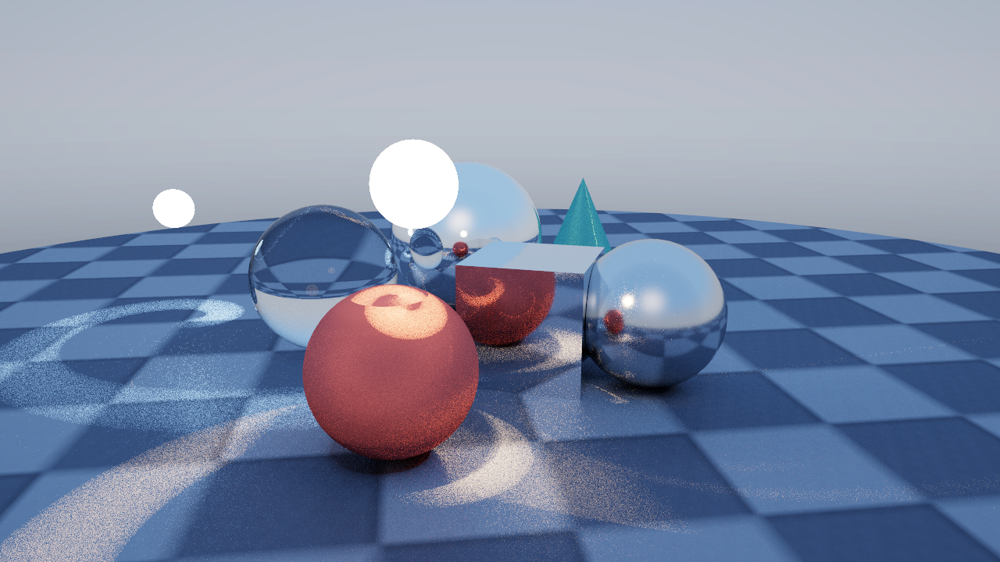

# Vulkan Ray Tracer - cube, cone, spheres, two lights, orbiting camera

A real-time GPU path tracer for Windows. Everything is rendered by tracing rays on the GPU with
Vulkan's standard ray-tracing extensions - no software rasterisation of the scene, no NVIDIA-only
APIs. The application is a single self-contained executable that loads its art from one `.pak`
(next, a plain ZIP file).

```
build\bin\raytracer.exe     <- the whole application, 745 KB, imports only OS DLLs
build\bin\scene.pak         <- scene description + textures, editable, no rebuild needed
```



## Running it

Double-click `build\bin\raytracer.exe`, or from a terminal:

```powershell
build\bin\raytracer.exe
```

* The window is a standard resizable Windows window - drag any border or maximise it and the render
  target follows.
* **ESC quits.** There is no other interaction: the camera orbits the scene continuously and the two
  lights orbit at their own rates.
* The title bar shows the live frame rate, the window size, the size actually being traced, the
  samples per pixel and which backend is active - for example
  `1280x720 trace 2560x1440 - 12 spp`.
* **Quality adapts itself to the GPU** (see below), so it holds 60 fps instead of rendering cheaply.
  On the machine it was built on that means tracing 2560x1440 with 11-12 samples per pixel for a
  1280x720 window, using about 12 ms of each 16.7 ms frame.

### Adaptive quality

The loop measures the GPU's own opinion of how long a frame took (two timestamp queries bracket the
command buffer, which costs nothing and never stalls), then spends the frame budget on quality:
first samples per pixel, then supersampling above the window's own resolution, then samples again.
The measured cost is close to proportional to pixels x samples, so the next setting is a prediction
rather than a search. Details that matter in practice:

* **Headroom is deliberate.** By default it targets 74% of the frame (`qualityHeadroom` 0.26), which
  is why the frame rate is flat rather than occasionally dropping a frame.
* A CPU-side pace watchdog also watches the real interval between frames: if vsync is being missed
  even though the command buffer fits, quality steps back, because present latency and background
  processes are invisible inside a command buffer.
* Inside a deadband (72%-104% of budget) it changes nothing at all, and outside it the controller
  waits for a streak of readings before acting, so a single slow frame from an unrelated process
  cannot make the image flicker in quality.
* It reacts to a resize or maximise within a few frames, and to a scene becoming more expensive the
  same way, since both simply change the measured cost.
* The window's own resolution is protected: supersampling is capped by `maxRenderScale` and by
  `maxTracePixels`, so a 4K window cannot exhaust video memory. Below the window's size it will only
  go if a single sample per pixel cannot make the frame; then it shrinks the trace target instead of
  dropping frames.

Options (all optional):

| Option | Meaning |
| --- | --- |
| `--capture N` | render N stills headless, write PNGs, exit (this is how correctness is verified) |
| `--accum S` | samples accumulated per still, default 48 |
| `--size WxH` | capture resolution, default 1280x720 |
| `--out DIR` | capture output directory, default `captures` |
| `--scale F` | baseline trace resolution 0.4-1.0; adaptive quality measures against this (1.0 = the window's own size) |
| `--no-auto-quality` | pin samples and scale instead of adapting to the GPU |
| `--target-fps N` | frame rate the controller aims for, default 60 |
| `--max-spp N` | most samples per pixel it may spend, default 16 |
| `--min-scale F` | smallest trace resolution it may fall back to, default 0.40 |
| `--compute` | force the compute + ray-query fallback instead of the ray-tracing pipeline |
| `--rt` | require the ray-tracing pipeline and fail if it is missing |
| `--pak FILE` | load a specific asset archive |
| `--autoexit S` | close the window by itself after S seconds (used by the automated smoke test) |
| `--verbose` | extra logging, including a per-phase frame-time breakdown |
| `--help` | usage |

Everything it says also goes to `build\bin\raytracer.log`, because a GUI-subsystem program has no
console when launched from Explorer.

## Building it

Requirements: Windows, Visual Studio Build Tools (the C++ workload), Python 3. Nothing else to
install - CMake, Ninja, the Vulkan headers and glslang are either already inside Build Tools or
fetched into `tools\`.

```powershell
.\build.ps1              # configure, compile, pack the assets
.\build.ps1 -Capture     # ... and then render verification stills
.\build.ps1 -Clean       # throw away build\ first
```

What the build does:

1. Imports the MSVC environment from `vcvars64.bat` and uses the CMake and Ninja that ship with
   Build Tools.
2. Runs `tools\build_shaders.py`, which flattens the `#include` graph in `shaders\`, compiles all
   eight stages to SPIR-V with `tools\glslang\bin\glslang.exe`, and emits a C++ header. The SPIR-V is
   embedded in the executable, so the exe needs no shader files.
3. Builds GLFW as a static library against the same static CRT (`/MT`), links volk, and produces one
   exe with no runtime dependencies beyond the OS.
4. Runs `tools\make_pak.py`, which (re)generates the textures and `scene.json` and writes
   `build\bin\scene.pak`.

The link is verified to be self-contained:

```
exe imports: SHELL32.dll, KERNEL32.dll, USER32.dll, GDI32.dll
```

## How it renders

One path-traced sample per pixel per frame, accumulated in an RGBA16F image, tone-mapped (ACES) and
blitted to the swap chain by a full-screen triangle. The transport loop is iterative inside the ray
generation shader - closest-hit shaders only report geometry - so `maxPipelineRayRecursionDepth` is
2 and the same loop is reused verbatim by the compute fallback through a host hook pair
(`traceShadingRay` / `occludedRay`) in `shaders\pt_common.glsl`.

Materials are Lambert, GGX metal, dielectric glass with Fresnel-weighted reflect/refract, and
emissive. Lighting is next-event estimated against two disc-sampled area lights with shadow rays, so
shadows are soft and the light spheres are visible in mirrors. The ground albedo comes from a PNG in
the `.pak`; if the archive is missing, a procedural checker is substituted and the render still works.

`scene.pak` and every file inside it are documented in `assets\README.txt`, which is itself packed,
so the instructions travel with the executable. Editing `scene.json` changes lights, materials,
camera speed, exposure and sample counts without recompiling.

## Hardware and fallback

Two backends, chosen at start-up and reported in the window title:

| | Path | Requires |
| --- | --- | --- |
| 1 | `VK_KHR_ray_tracing_pipeline` + `VK_KHR_acceleration_structure`, tracing a device TLAS | any Vulkan 1.2/1.3+ GPU with hardware RT |
| 2 | compute shader + `VK_KHR_ray_query` over the *same* TLAS and the same shading code | no RT pipeline, e.g. Intel UHD 770 |

Verified on both adapters present in the build machine: the NVIDIA card takes path 1, and forcing
`--compute` renders the identical scene through path 2 (see `captures\compute-fallback.png`).

## What was actually checked

* **The window itself, on screen.** `--capture` shares the tracer with the window but not the
  present pass, so a headless green run does not prove the window works. `tools\window_probe.ps1`
  screenshots the desktop while the app runs, and that is what caught the black-window bug (the
  render pass had been built before the swap chain existed, so it had no colour format and quietly
  dropped every draw while still clearing).
* `--capture 2 --accum 128 --size 1280x720` on the ray-tracing pipeline, and the result inspected:
  the cube, cone, four spheres, both light spheres, their reflections in the metal, their refraction
  through the glass, soft shadows and the floor caustics are all there.
* The same scene through the compute fallback (`captures\compute-fallback.png`).
* A windowed run: 60 fps sustained; the render also verified at 540x380 and at maximised 3840x2019.
* **The adaptive controller, measured rather than assumed.** 20 s untouched: 59.8-60.0 fps, settling
  at 2x supersampling with 11-12 samples per pixel and about 12 ms of GPU work per frame. Maximising
  mid-run (8x the pixels) made it drop to 1.05x scale and 4-5 samples within about a second, and
  restoring the window returned it to 2x and 9-12 samples, with roughly five quality changes in the
  whole 26 s rather than a continuous flutter. The numbers are logged with `--verbose`.
* The asset path: `scene.json` read from the `.pak` drives the render; deleting the archive falls
  back to compiled-in defaults and says so in the log.

Known issue: on a DPI-scaled display, maximising leaves the framing zoomed and off-centre. The
measured extents all agree and the same resolution renders correctly headlessly, so it is isolated to
the windowed present path at that size and is still open; at ordinary window sizes the framing is
correct. Everything else above is verified.


## Repository layout

```
CMakeLists.txt            build definition; also refuses to build against a stale generated header
build.ps1                 one-command build (finds Build Tools, glslang, Python itself)
shaders/                  GLSL: rt entry points, present pass, and the shared path-tracing core
src/                      Vulkan setup (core*.cpp), windowing + frame loop (frame.cpp), scene model,
                          pak reader (zip + inflate + crc32), tolerant JSON parser
tools/build_shaders.py    include flattening + glslang invocation + SPIR-V header emitter
tools/make_pak.py         generates textures/scene.json and writes scene.pak
tools/window_probe.ps1    screenshots the real window while it renders - the present-path check
assets/                   source files that go into the pak
third_party/              volk, GLFW 3.4, stb, Vulkan-Headers (all MIT/PD/zlib licensed, see LICENSE
                          files alongside each)
captures/                 verification stills produced by the runs above
DESIGN.md                 the design spec, including the API gotchas found while implementing it
```
